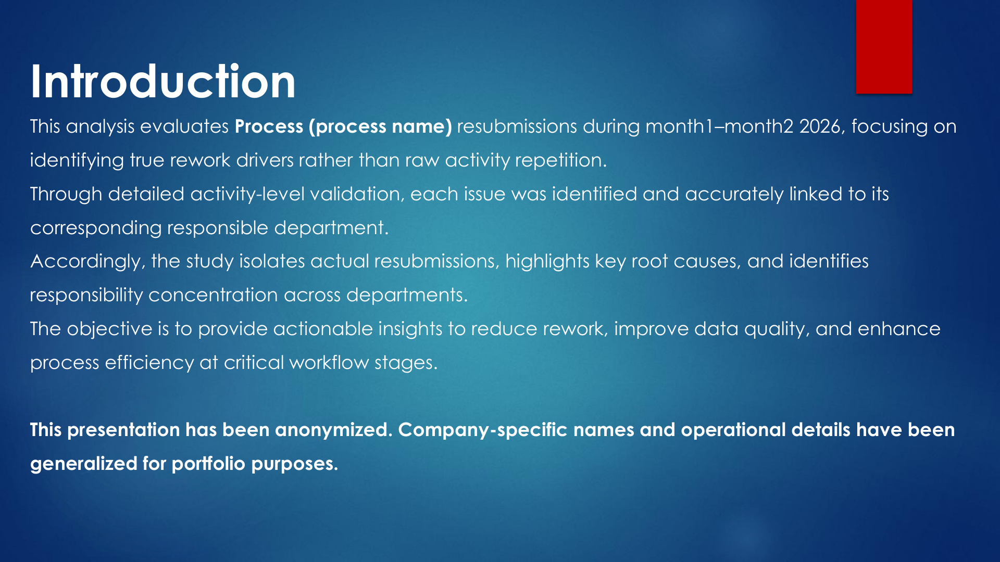
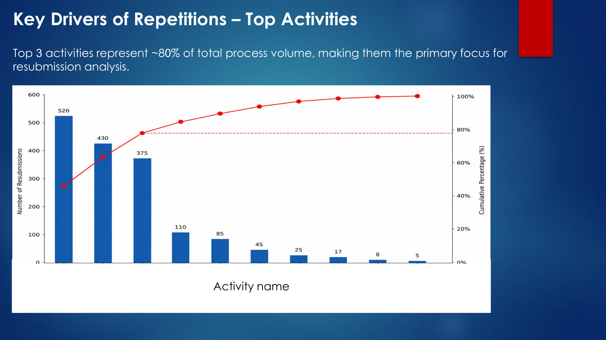
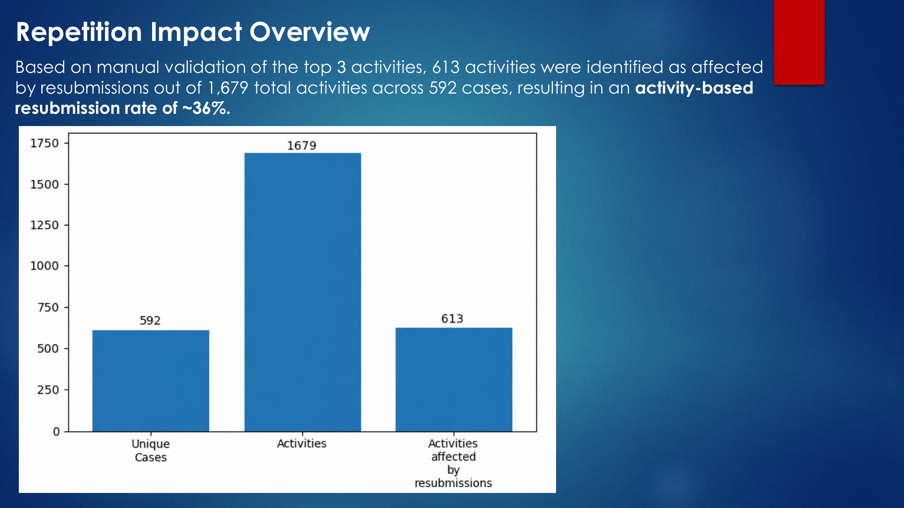
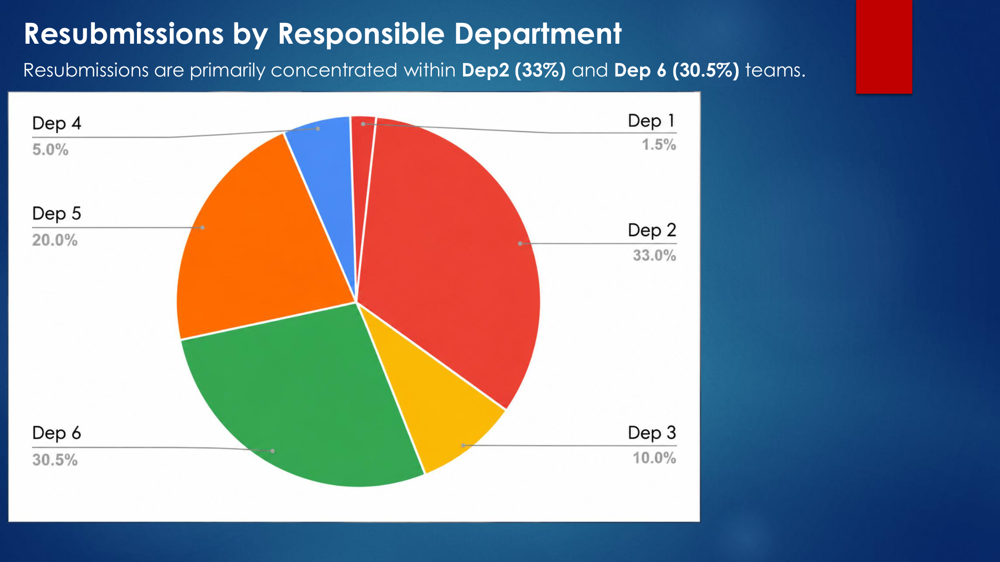
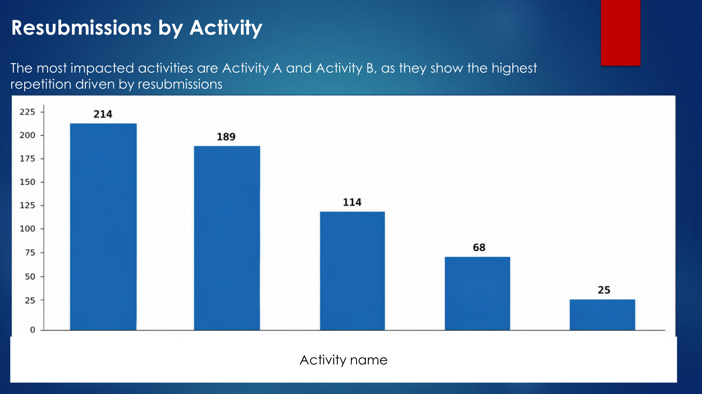
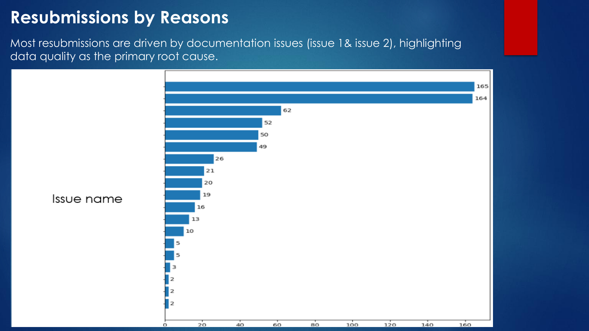
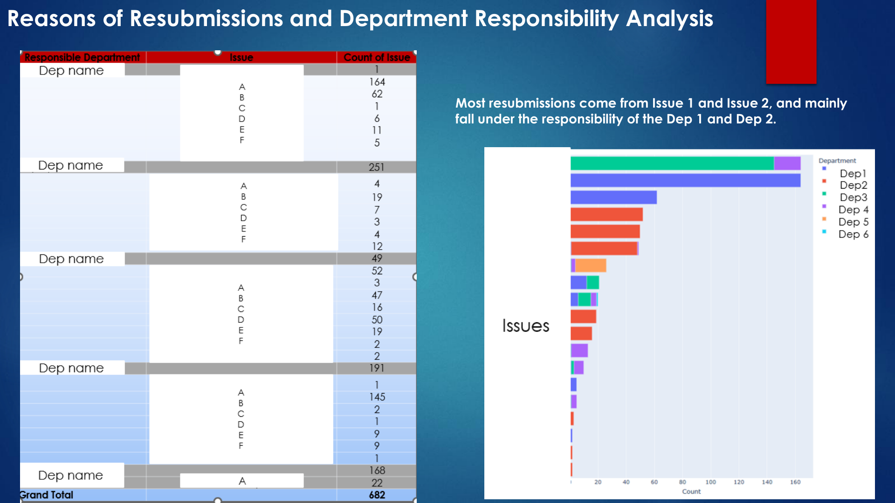
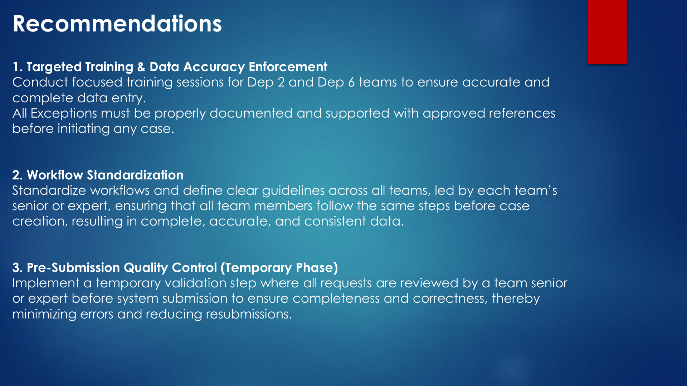

# Process 02 – Repetition & Root Cause Analysis

## Overview

This case study analyzes activity repetitions within a business process during a selected period in 2026, focusing on distinguishing normal operational repetitions from avoidable resubmissions caused by specific issues.

Rather than treating every repeated activity as rework, the analysis applies detailed activity-level validation to isolate actual resubmissions, identify their root causes, and map each issue to the responsible department.

The objective is to uncover the main drivers of avoidable rework, highlight areas of responsibility, and provide targeted recommendations to improve data quality and operational efficiency.

## Analytical Approach

### 1. Pareto Analysis – Identifying Key Activities

Applied Pareto analysis to identify the activities with the highest repetition volumes and prioritize the investigation.

- Ranked activities based on repetition volume.
- Identified the top three activities.
- Focused detailed validation on the highest-volume activities.

The top three activities represented approximately 80% of the total process activity volume.

### 2. Manual Validation – Distinguishing Normal Repetition from Rework

Conducted detailed manual validation of the selected activities to distinguish between:

- **Normal Repetition:** Repeated activities occurring as part of the normal operational workflow.
- **Avoidable Resubmissions:** Repeated activities resulting from returned submissions due to identifiable issues.

This validation helped isolate actual rework instead of classifying all repeated activities as process errors.

### 3. Repetition Impact Assessment

Quantified the scale of activity repetitions and their impact on the reviewed process.

The analysis identified:

- 1,679 total activities across 592 cases.
- 613 activities identified as affected by resubmissions.
- An activity-based resubmission rate of approximately 36%.

### 4. Department Responsibility Analysis

Examined how actual resubmissions were distributed across responsible departments to identify where rework was most concentrated.

The analysis highlighted Dep 2 (33%) and Dep 6 (30.5%) as the departments with the highest shares in the department distribution.

### 5. Activity-Level Analysis

Analyzed resubmissions by activity to identify the operational stages most affected by avoidable rework.

This helped highlight activities requiring closer attention and potential process improvements.

### 6. Root Cause Analysis

Investigated the specific reasons behind resubmissions to identify recurring operational issues.

The analysis covered:

- Distribution of resubmissions by reason.
- Identification of the most frequent issues.
- Analysis of issue distribution across responsible departments.
- Mapping of specific problems to the departments responsible for them.

Documentation-related issues emerged as major contributors to resubmissions.

## Key Findings

- The top three activities represented approximately 80% of total process activity volume.
- Manual validation identified 613 activities affected by resubmissions out of 1,679 total activities, equivalent to approximately 36%.
- Department-level analysis showed the highest shares in Dep 2 (33%) and Dep 6 (30.5%).
- Documentation-related issues were among the main drivers of resubmissions.
- Linking individual issues to responsible departments helped identify where corrective actions should be focused.

## Recommendations

### 1. Targeted Training & Data Accuracy Enforcement

Conduct focused training for the departments most associated with resubmissions to improve data entry accuracy and completeness.

Ensure that all exceptions are properly documented and supported by approved references before case initiation.

### 2. Workflow Standardization

Establish consistent workflows and clear operational guidelines across teams.

Assign senior or experienced team members to lead standardization and ensure that all employees follow consistent procedures before case creation.

### 3. Pre-Submission Quality Control

Introduce a temporary validation stage in which requests are reviewed by a team senior or subject-matter expert before system submission.

This control is intended to identify incomplete or incorrect information before submission and reduce avoidable resubmissions.

## Business Value

This analysis provides a deeper understanding of operational repetition by separating normal workflow activity from avoidable rework.

By identifying the main repetition drivers, validating actual resubmissions, and mapping root causes to responsible departments, the study supports targeted corrective actions, improved data quality, and more efficient process execution.

## Deliverables

- Pareto analysis of high-volume activities.
- Manual activity-level validation.
- Resubmission impact assessment.
- Department and activity distribution analysis.
- Root cause and responsibility analysis.
- Process improvement recommendations.
- Analytical presentation.

## Screenshots

### 1. Introduction

### 2. Pareto Analysis

### 3. Repetition Impact

### 4. Department Analysis

### 5. Activity Analysis

### 6. Root Cause Analysis

### 7. Department Responsibility

### 8. Recommendations

## Data Confidentiality

This case study has been anonymized for portfolio purposes. Process identifiers, activity names, department names, and operational details have been generalized. No proprietary source data is included.

*Note: All reported figures are based on the analyzed and validated dataset. The resubmission rate is activity-based.*
