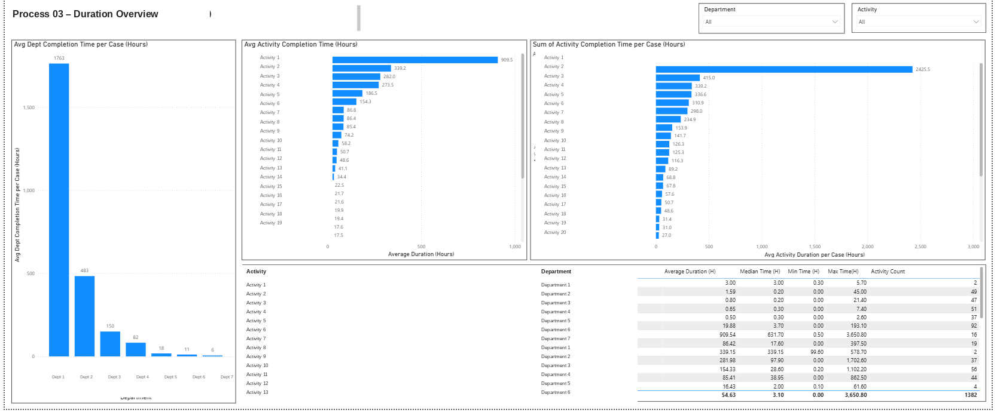
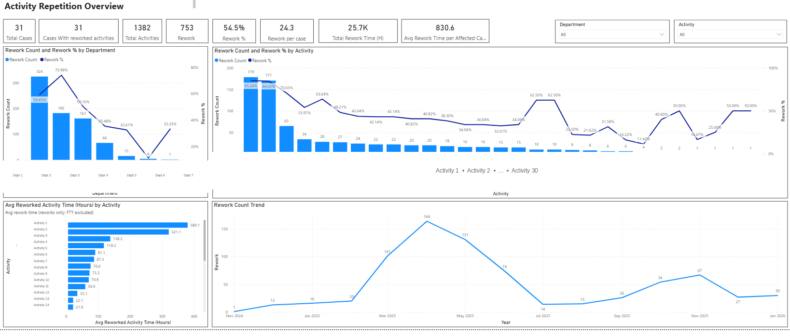

# Process 03 – Operational Duration & Activity Repetition Analysis

## Overview

This case study analyzes operational processing duration and activity repetition patterns within a business process, based on stakeholder requirements.

The analysis focuses on two key dimensions of process performance:

1. **Processing Duration:** Understanding how much time departments and individual activities require to complete their work, and identifying the activities contributing most to overall case completion time.
2. **Activity Repetition:** Measuring repeated activities, their frequency, time consumption, and contribution to operational workload.

The objective is to provide stakeholders with interactive visibility into processing efficiency, activity-level workload, and repetition trends without investigating the root causes of repetitions.

## Analytical Scope

### 1. Processing Duration Analysis

Evaluated processing time across departments, activities, and individual cases to understand where operational time is being consumed.

The analysis included:

**Department-Level Completion Time**
- Calculated average case completion time for each department.
- Compared departments to identify which teams require more time to complete their assigned work.

**Activity-Level Completion Time**
- Calculated average completion time for individual activities.
- Compared activities to identify those requiring the longest processing time.

**Total Activity Duration per Case**
- Analyzed the accumulated completion time of each activity within a case.
- Included both single-occurrence and repeated activities.
- Identified activities contributing the most to total case processing time.

### 2. Activity Repetition Analysis

Measured the frequency and operational impact of repeated activities across cases.

The analysis included:

- Total number of cases.
- Number of cases containing repeated activities.
- Total number of activities.
- Total number of repeated activities.
- Activity repetition percentage.
- Average number of repetitions per case.
- Total time consumed by repeated activities.
- Average repetition time per affected case.

### 3. Repetition Distribution Analysis

Examined how repeated activities were distributed across the process to identify where repetition was most concentrated.

The analysis covered:

- Repetition counts and percentages by activity.
- Repetition distribution across cases.
- Identification of activities with higher repetition volumes.

### 4. Repetition Duration Analysis

Focused specifically on the time consumed by repeated activities, separating repetition-related time from the overall activity completion duration.

The analysis included:

- Average time consumed by repetitions for each activity.
- Comparison of repetition duration across activities.
- Identification of activities with the highest average repetition time.

### 5. Repetition Trend Analysis

Analyzed repetition volumes over time to identify monthly fluctuations and periods with increased repetition activity.

This provided visibility into:
- Monthly repetition trends.
- Periods with higher repetition volumes.
- Changes in repetition patterns over the selected reporting period.

## Key Metrics

The interactive dashboard includes the following performance indicators:

- Total Cases
- Cases with Reworked Activities
- Total Activities
- Rework Count
- Rework Percentage
- Average Rework per Case
- Total Rework Time (Hours)
- Average Rework Time per Affected Case

## Interactive Dashboard Features

The Power BI dashboard provides interactive filtering and visual analysis through:

- Department filters.
- Activity filters.
- Department-level and activity-level comparisons.
- Repetition distribution charts.
- Processing duration charts.
- Monthly repetition trend visualization.
- Detailed activity duration statistics, including average, median, minimum, and maximum duration.

## Business Value

This analysis provides operational stakeholders with visibility into both processing duration and repeated activity workload.

It helps identify departments and activities requiring more processing time, quantify the time consumed by repetitions, and monitor repetition trends over time.

The resulting insights support workload assessment, operational performance monitoring, and more informed process improvement decisions.

## Deliverables

- Interactive Power BI dashboard.
- Department-level processing duration analysis.
- Activity-level completion time analysis.
- Case-level accumulated activity duration analysis.
- Activity repetition overview.
- Repetition distribution and time impact analysis.
- Monthly repetition trend analysis.
- 

This case study has been anonymized for portfolio purposes. Process identifiers, department names, activity names, and operational details have been generalized. No proprietary source data is included.

*Note: Repetition analysis focuses on frequency and time impact. Root cause investigation was outside the scope of this stakeholder-requested analysis.*
