# Process 04 – Resubmission Root Cause & Delay Impact Analysis

## Overview

This case study analyzes resubmissions within a newly introduced business process during its initial operating period, focusing on identifying the main drivers of rework and quantifying their actual impact on process completion time.

The analysis goes beyond measuring resubmission frequency by examining the operational delay caused by each completed resubmission cycle, identifying activities responsible for the highest accumulated delays, and investigating their underlying causes.

By combining operational performance measurement, time-based analysis, Pareto prioritization, and detailed manual case investigation, this study provides actionable recommendations to reduce avoidable resubmissions and improve process efficiency.

## Analytical Approach

### 1. Resubmission Volume & Case Impact

Established an overview of resubmission activity across the analyzed process.

The analysis measured:

- Total number of cases.
- Number and percentage of cases containing at least one resubmission.
- Total resubmission occurrences.
- Average number of resubmissions per case.

The results showed that approximately 71% of the 300 analyzed cases experienced at least one resubmission, with an average of 2.3 resubmissions per case.

### 2. Monthly Resubmission Trend Analysis

Analyzed resubmission volumes across the initial operating months to understand how repetition patterns evolved after process introduction.

The analysis revealed:

- Higher resubmission volumes during the initial stabilization period.
- A decline in resubmissions during the following month.
- An improvement in process usage as teams became more familiar with the new workflow.
- Remaining resubmissions that still required corrective actions.

Monthly averages were calculated based on unique cases active in each month. Since cases may appear in multiple months, these averages are not directly comparable to the overall average.

### 3. Impact of Resubmissions on Case Completion Time

Evaluated the effect of resubmissions on overall case completion time.

To ensure a consistent comparison, the analysis considered completed cases only and classified them into two groups:

- Cases containing resubmitted activities.
- Cases without resubmitted activities.

Average completion time was calculated for both groups.

The analysis showed that cases involving resubmissions required approximately twice the completion time of cases following a clean process flow.

### 4. Resubmission Frequency vs. Delay Impact

Investigated whether resubmission frequency or the time consumed by each resubmission had a greater impact on operational performance.

For each completed resubmission cycle, the delay was measured from the moment an activity was returned until the case returned to the same activity.

The calculation excluded hold time to capture the actual operational delay associated with resubmissions.

The analysis included:

- Number of resubmissions by activity.
- Delay duration for each resubmission event.
- Accumulated resubmission delay by activity.
- Comparison between resubmission frequency and time impact.

Only completed resubmission cycles with a measurable delay were included. Incomplete cycles, where the activity had not returned or no measurable delay was available, were excluded.

This comparison demonstrated that repetition frequency alone does not fully represent operational impact. Some activities generate fewer returns but consume considerably more time per resubmission.

### 5. Pareto Analysis – Activities Driving the Highest Delays

Applied Pareto analysis based on accumulated resubmission delay to identify the activities contributing most to operational delays.

The analysis identified three activities responsible for more than 82% of total resubmission-related delays.

Prioritizing these activities provided a focused approach to improvement by directing attention toward the areas with the greatest potential for delay reduction.

### 6. Manual Root Cause Investigation

Conducted detailed manual investigation of the activities identified through Pareto analysis.

Each relevant case was reviewed individually to understand the specific circumstances behind returned activities and identify the underlying issues contributing to delays.

The investigation focused on:

- Reviewing individual resubmission cases.
- Identifying specific reasons behind returned activities.
- Examining recurring issues across cases.
- Linking identified causes to the activities generating the highest delays.
- Identifying the main root causes requiring corrective action.

This investigation required substantial manual effort but provided valuable insights beyond what could be obtained from automated repetition counts alone.

When unclear or unidentified reasons were excluded, four main root causes were identified as contributors to resubmission issues.

## Key Findings

- Approximately 71% of the 300 analyzed cases experienced at least one resubmission.
- The average number of resubmissions was 2.3 per case.
- Resubmission volumes peaked during the initial stabilization period and declined in the following month.
- Cases involving resubmissions experienced approximately twice the completion time of cases without resubmissions.
- Resubmission-related delay, measured after excluding hold time, provided a more meaningful basis for prioritizing improvement efforts than frequency alone.
- Three activities accounted for more than 82% of total resubmission-related delays.
- Manual case-by-case investigation identified four main root causes after excluding unclear or unidentified reasons.

## Recommendations & Improvement Actions

### 1. Standardize Resubmission Reasons

Introduce a mandatory predefined list of resubmission reasons using a drop-down selection instead of free-text entries.

This will improve data consistency, support reliable root cause analysis, and enable better monitoring of recurring issues.

### 2. Improve Departmental Routing

Automatically route cases to the responsible department based on the selected resubmission reason.

This approach aims to reduce incorrect returns to unrelated departments and minimize delays caused by repeated misrouting.

### 3. Targeted Training

Provide focused training for the departments most associated with resubmission issues, addressing:

- **Process Flow:** Ensure teams understand the end-to-end workflow and required handovers.
- **Process Forms:** Clarify where and how required information fields should be completed.
- **Departmental Responsibilities:** Define the roles and accountability of each involved department.

### 4. Continuous Monitoring & Control

Establish ongoing monitoring through:

- Monthly resubmission and delay impact reporting.
- Regular review of resubmission trends and responsible departments.
- Continuous training on correct process usage.
- Follow-up on the effectiveness of implemented corrective actions.

## Improvement Framework – DMAIC

The study follows a structured improvement approach:

**Define**
Identify resubmissions as a major source of operational delay and understand their impact on process performance.

**Measure**
Quantify resubmission volumes, affected cases, completion time differences, and total delay impact.

**Analyze**
Prioritize delay-driving activities using Pareto analysis and investigate their underlying causes through manual case-level validation.

**Improve**
Introduce standardized resubmission reasons, targeted training, and improved departmental routing.

**Control**
Monitor monthly resubmission trends, delay impact, and departmental performance to sustain improvements.

## Business Value

This analysis provides stakeholders with a deeper understanding of how resubmissions affect operational performance, highlighting the importance of measuring delay impact rather than relying on repetition counts alone.

By identifying the activities responsible for the highest delays and investigating their underlying causes, the study supports targeted corrective actions, improved departmental accountability, and more efficient process execution.

It also provides insight into the stabilization of a newly introduced process and establishes a foundation for continuous performance monitoring.

## Deliverables

- Resubmission volume and affected-case analysis.
- Monthly resubmission trend analysis.
- Completed-case duration comparison.
- Resubmission frequency versus delay impact analysis.
- Pareto analysis of delay-driving activities.
- Manual case-by-case root cause investigation.
- Targeted process improvement recommendations.
- DMAIC-based improvement and control framework.
- Analytical presentation.

  ## Dashboard & Analysis Screenshots

### 1. Introduction
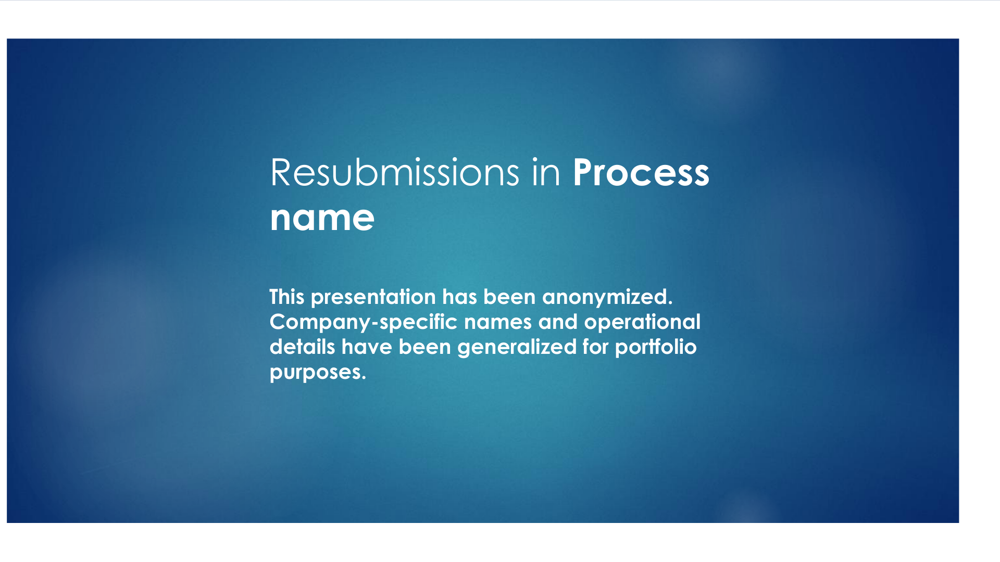

### 2. Resubmission Summary
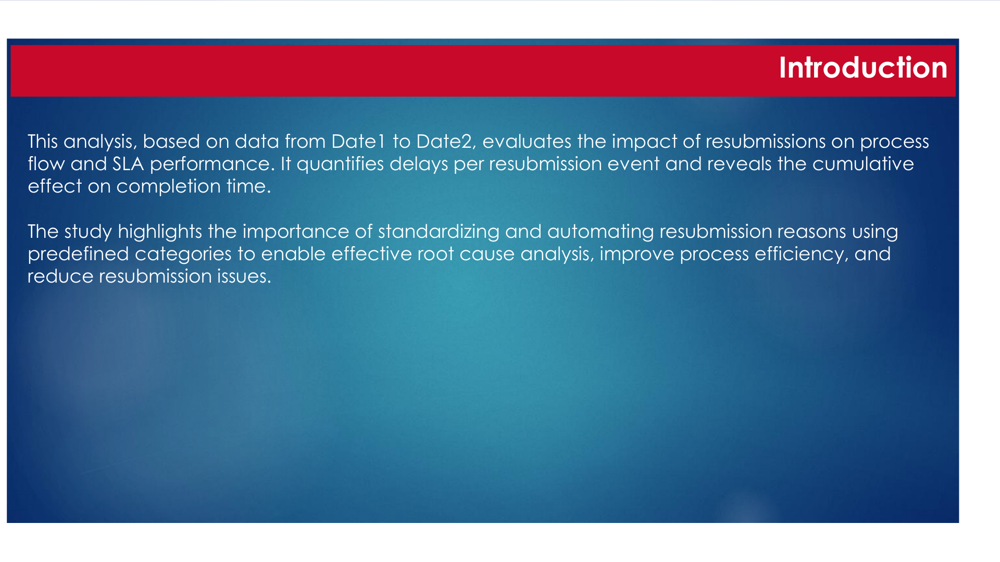

### 3. Monthly Resubmission Trend
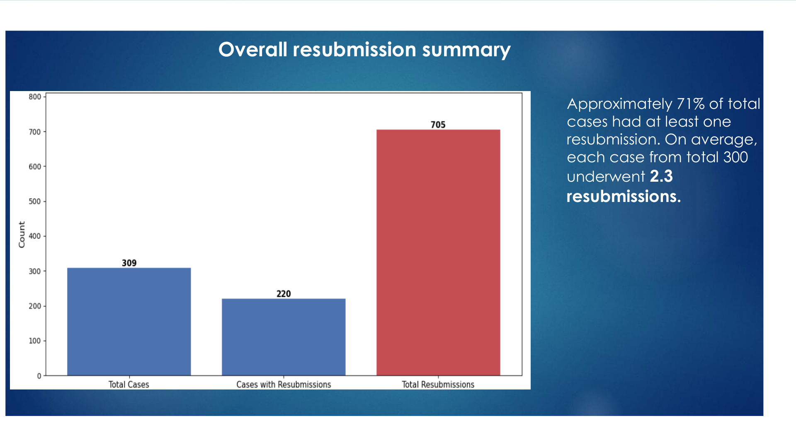

### 4. Completion Time Comparison
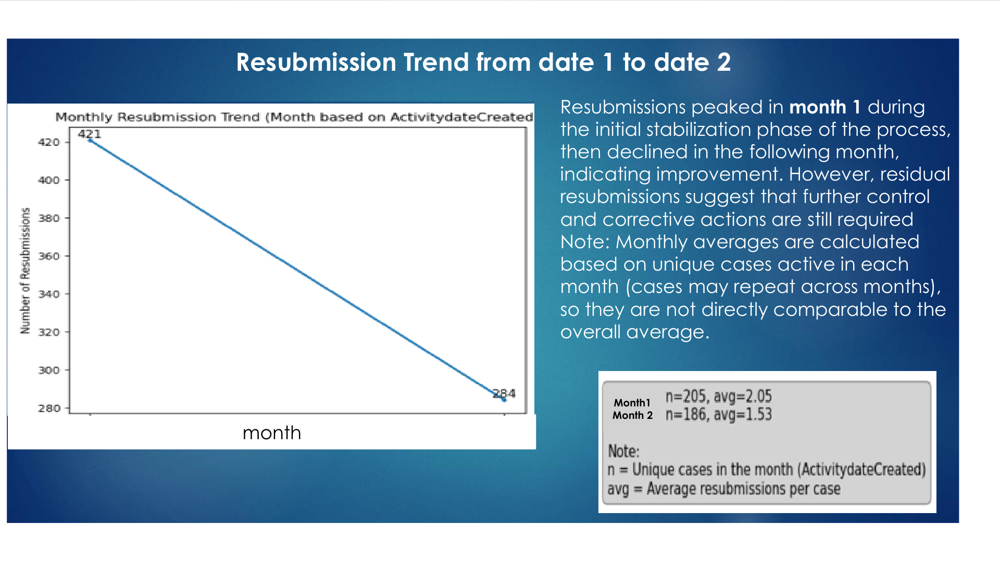

### 5. Frequency vs. Delay Impact
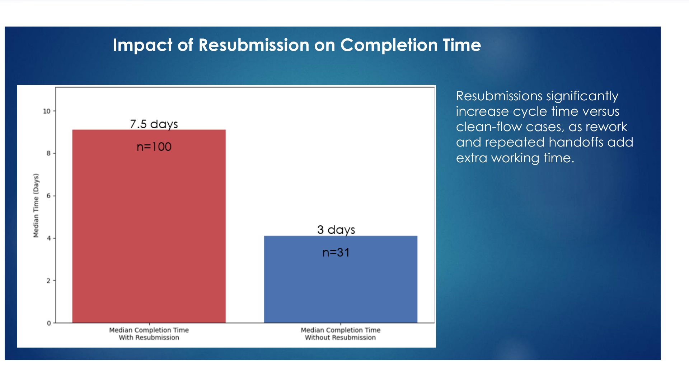

### 6. Pareto Delay Analysis
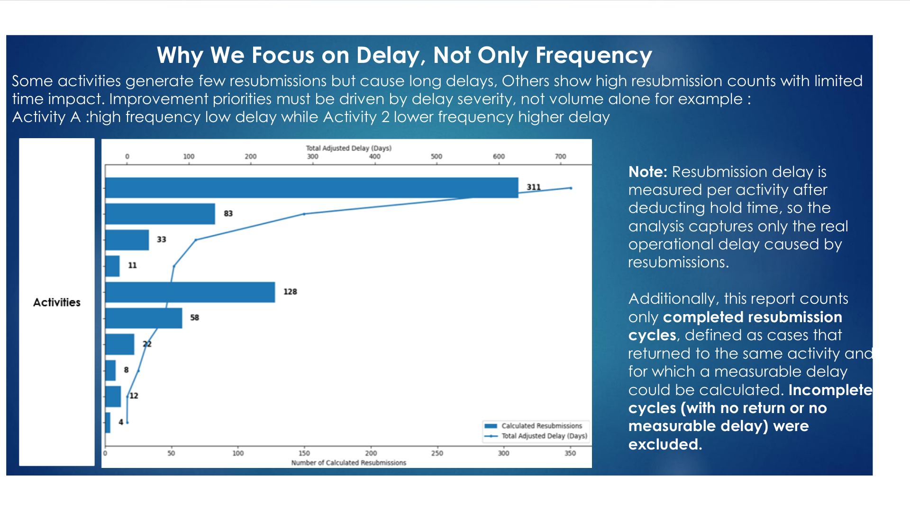

### 7. Root Cause Analysis
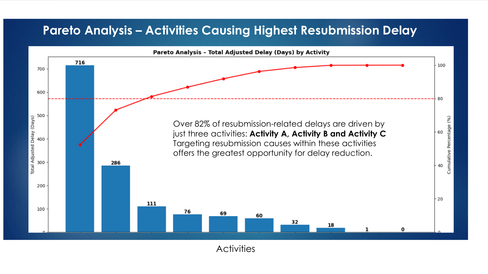

### 8. Define, Measure & Analyze
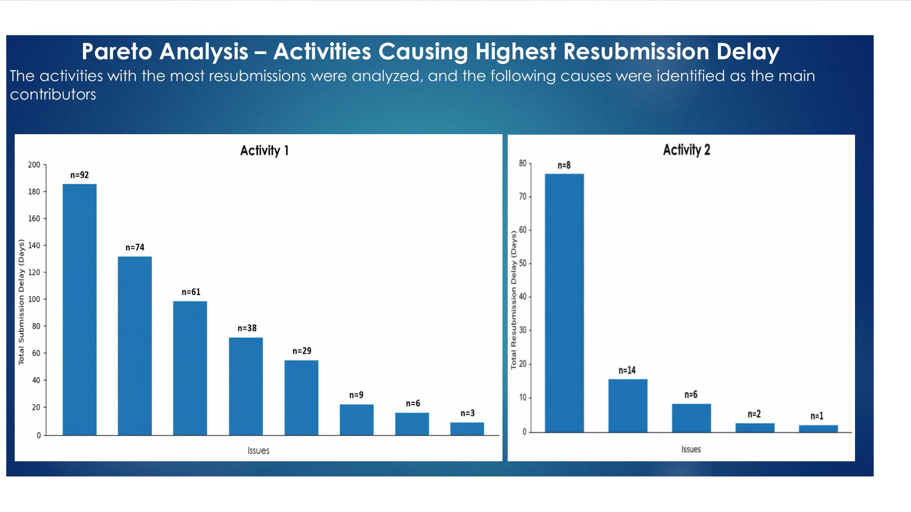

### 9. Improve & Control
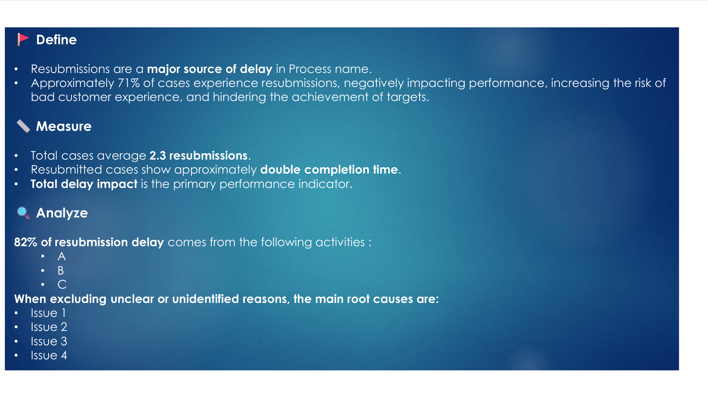

### 10. Resubmission Reasons
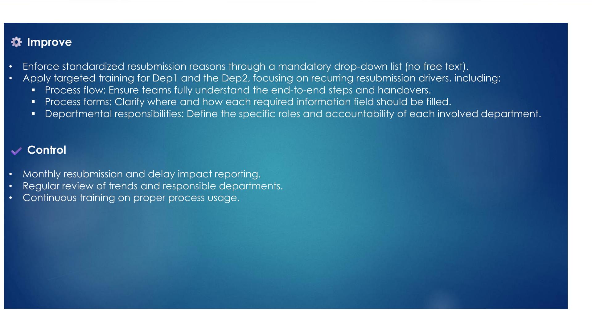

### 11. Appendix
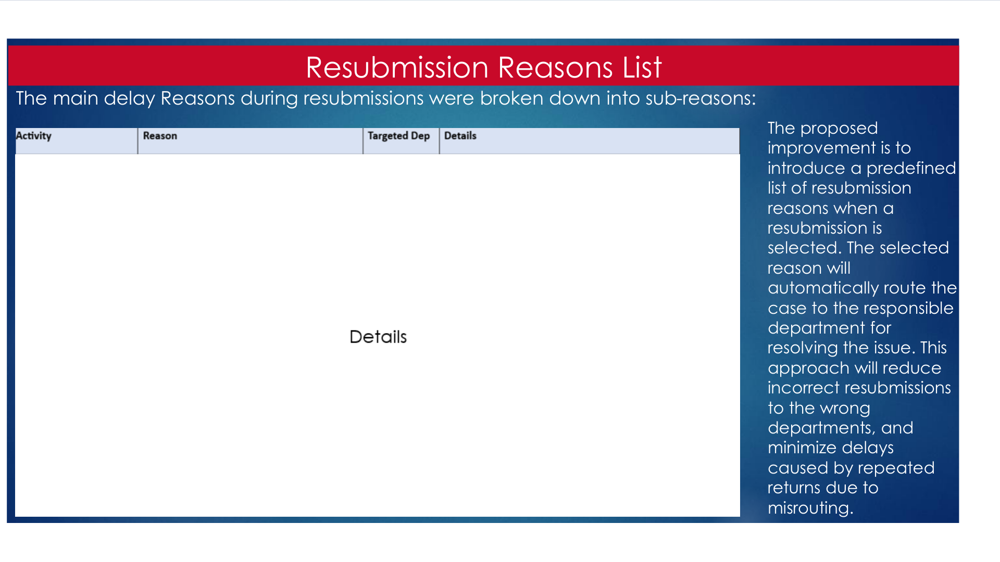

## Data Confidentiality

This case study has been anonymized for portfolio purposes. Process identifiers, activity names, department names, dates, and operational details have been generalized. No proprietary source data is included.
